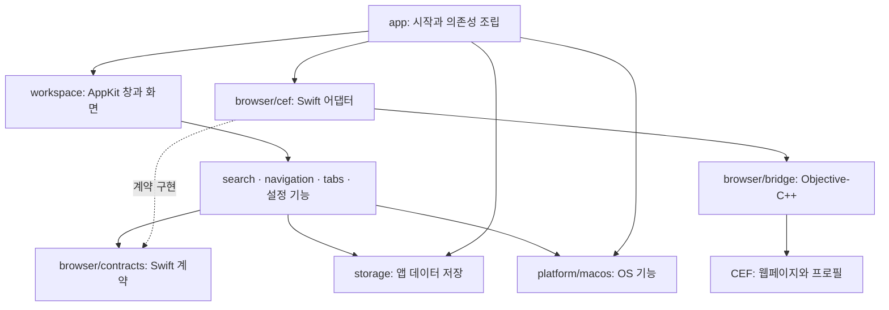

# Jena Web 프로그램 구조

> **2026-11-13 엔진 교체**: 제품 엔진은 시스템 WebKit이다. 아래에서 CEF 어댑터·Objective-C++ 연결부·헬퍼 프로세스·CEF 프로필로 설명한 엔진 경계는 `Sources/browser/webkit/WebKitBrowserRuntime.swift` 한 파일이 같은 Swift 계약(`BrowserRuntime`·`BrowserPrivacy`·`SiteSettingsEngine`)으로 대신한다. 엔진 밖 구조(app·workspace·tabs·storage 등)는 그대로다. CEF 관련 서술은 `JENA_ENGINE=CEF` 빌드에만 해당한다.

- 결정일: 2026-11-12
- 상태: 제품 구현 기준. Swift·AppKit + CEF 채택 확정. 추가 기술 검증은 진행하지 않는다.
- 기준: 기존 기획·PRD 및 사용자의 macOS 우선, 검증 종료 결정.
- 현재 구현: 소스 디렉터리와 책임·연결 설계에 이어 제품 앱·CEFBridge·Helper 타깃 및 첫 탐색 화면을 연결했다. 빌드 방법은 [BuildSupport](../BuildSupport/README.md)를 따른다.

## 1. 앱의 구성

Swift·AppKit이 창, 탭 표시, 검색 입력, 메뉴, 설정과 앱 동작을 소유한다. CEF는 웹 콘텐츠, 페이지 탐색과 웹 프로필을 담당한다. 파일 선택, 외부 앱 열기, OS 설정 이동 등은 macOS 기능으로 처리한다. 모든 기능을 CEF 안에서 해결하지 않는다.

단일 사용자의 로컬 macOS 앱을 전제로 한다. 현재 Windows 공통 계층, 서버, 동기화, 플러그인 체계는 만들지 않는다. 경계는 실제 외부 의존성인 CEF·OS·저장소에만 둔다. 기능마다 별도 프레임워크나 서비스 프로세스를 만들지 않는다.



UI와 기능 코드는 CEF 헤더·포인터·DevTools 명령을 직접 사용하지 않는다. CEF 내부 명령을 사용하는 기존 구현은 어댑터 내부에 둔다. 임의 웹페이지에 앱의 설정·파일·삭제 기능을 노출하지 않는다.

## 2. 실제 디렉터리

```text
Sources/
  app/                 앱 진입점, 메뉴, 의존성 조립, 종료 순서
  workspace/           AppKit 창, 툴바, 탭 표시, 웹 호스트 배치
  search/              검색 제공처, 웹·이미지 검색 URL 구성
  navigation/          입력 해석, 이동 의도, 현재/새 탭 목적지
  tabs/                탭 목록·선택·닫기와 페이지 수명 조정
  bookmarks/           북마크 모델·작업·관리 화면
  history/             방문 기록 모델·기록·조회
  privacy/             삭제 대상·영향·실행·결과와 화면
  site-settings/       사이트 권한·쿠키·팝업 정책과 화면
  settings/            검색·탭 등 앱 설정과 화면
  browser/
    contracts/         기능 코드에서 사용하는 Swift 타입·인터페이스
    cef/               Swift CEF 어댑터, 엔진 이벤트·정책 연결
    bridge/            Objective-C++ wrapper, helper 진입점
  platform/macos/      OS 권한, 경로, 파일 선택, 외부 앱 연결
  storage/             앱 SQLite 연결, 마이그레이션, 저장 구현
Resources/             앱 리소스, 검색 제공처 정의
Configuration/         앱·helper Info.plist, 서명·배포 설정
BuildSupport/          CEF framework·helper 번들 조립
validation/            기존 실험 코드와 증거 보존; 제품 의존성 아님
```

현재 app·workspace·tabs·search·navigation과 browser 연결부를 구현했다. 설정·북마크와 storage의 SQLite 저장소도 연결했다. 기록·개인정보 삭제·사이트별 권한 및 쿠키 기본 설정 화면도 연결했다. 아래 타입명 중 미구현 항목은 후속 배치 기준이다. 각 기능은 처음에는 소수의 Swift 파일로 시작하고, 파일이 늘어날 때만 내부 하위 폴더를 나눈다.

## 3. 시작점과 화면

| 위치 | 주요 타입 | 역할 |
|---|---|---|
| app | AppDelegate, AppComposition | 앱 시작, 구현체 생성·연결, 메뉴·명령 라우팅 |
| app | AppLifecycle | CEF 시작과 종료, 창 종료 요청 조정 |
| workspace | BrowserWindowController | 네이티브 창 소유, 표준 닫기·최소화·확대 제공 |
| workspace | BrowserWorkspaceController | 검색 입력·탭 표시·콘텐츠 영역 연결 |
| workspace | BrowserToolbarView, TabStripView | 사용자 입력과 표시; 탐색 정책은 소유하지 않음 |
| workspace | WebContentHostView | 선택된 탭의 NSView 표시; 페이지를 직접 만들거나 파괴하지 않음 |

앱 창은 표준 macOS 창 버튼을 제공한다. 이번 검증 앱의 닫기 버튼 없는 창 구성을 제품으로 가져오지 않는다. 초기 화면은 네이티브 검색 입력과 빈 탭 안내이며, 검색 결과 자체는 외부 검색 페이지다.

보조 화면도 우선 AppKit으로 연결한다. SwiftUI가 편리한 독립 설정 화면은 나중에 부분 적용할 수 있지만, 현재 구조에 SwiftUI 의존성을 추가하지 않는다. 시각 디자인·레이아웃 세부는 이번 구조 작업의 범위가 아니다.

## 4. 탭과 웹페이지의 소유권

- AppComposition은 엔진 런타임과 일반 탐색 프로필을 앱 수명 동안 하나씩 소유한다.
- TabService는 창별 탭 순서·선택을 소유한다. 각 TabID에는 하나의 BrowserPage 핸들이 연결된다.
- BrowserPage 어댑터는 해당 CEF browser와 호스트 NSView의 수명을 관리한다. 표시 탭이 바뀌어도 페이지를 재생성하지 않는다.
- 실제 URL, 제목, 로딩, 뒤로/앞으로 가능 상태는 엔진 이벤트로 갱신한다. 입력 중인 문자열은 UI가 별도로 유지한다.
- 탭 닫기는 close 요청 → 엔진의 닫힘 완료 → 탭/호스트 해제 순서다. beforeunload 취소는 유지한다.
- 앱 종료도 모든 browser의 닫힘 완료 후 CEF를 종료한다. 강제 프로세스 종료를 정상 흐름으로 사용하지 않는다.
- 앱 UI 변경은 MainActor에서 처리한다. bridge는 CEF 작업과 Swift 이벤트 전달을 각 실행 문맥에 맞춰 연결한다.

일반 탭은 하나의 영속 웹 프로필을 공유한다. 탭별로 프로필을 생성하지 않는다. 사이트별 로그인 만료와 유효성은 사이트가 결정하며 앱에 별도 로그인 boolean이나 비밀번호 저장을 만들지 않는다.

## 5. 엔진 연결 계약

| 계약 | 책임 |
|---|---|
| BrowserRuntime | 엔진 초기화, 일반 프로필 연결, 종료 |
| BrowserPage | URL 이동, 뒤로·앞으로, 새로고침·중지, 닫기 요청 |
| BrowserEvent | URL·제목·로딩 변경, 이동 실패, 닫힘, 새 페이지 요청 |
| NavigationRequest / Decision | 사용자 동작·frame·폼·팝업 등의 정보를 받아 목적지 결정 |
| BrowserProfile | 엔진 사이트 데이터·쿠키 정책·권한·삭제 접근 |
| BrowserSurfaceProvider | workspace에 NSView 제공; AppKit 의존은 이 화면 연결 경계에 한정 |

기능 판단용 타입은 Foundation 수준으로 유지한다. BrowserSurfaceProvider만 네이티브 뷰 타입을 사용한다. CEF의 popup을 단순 URL 복사로 새로 열지 않는다. 기존의 관리 browser 수용 방식을 연결해 POST·opener·인증 문맥을 유지한다.

CEF에 없는 기능은 이 경계에서 지원 여부·오류를 명확히 전달하고, 해당 기능의 응용 서비스가 macOS 기능 등 적절한 경로를 선택한다. 탐색 엔진을 몰래 교체하거나 사이트의 보안 경계를 우회하는 fallback은 만들지 않는다.

## 6. 핵심 흐름

1. 입력 실행: workspace → NavigationService(주소/검색 판별) → SearchService(필요 시 URL 생성) → TabService → BrowserPage.
2. 페이지 링크: bridge의 실제 탐색 정보 → NavigationService의 기존 분류 → 현재 페이지 유지 또는 관리 탭 생성.
3. 페이지 상태: CEF callback → bridge → Swift 어댑터 → TabService 상태 → workspace 표시.
4. 북마크: 현재 탭의 실제 URL·제목 → BookmarkService → 저장소 → 북마크 화면.
5. 데이터 삭제: PrivacyService가 사용자가 선택한 범위를 확정 → 앱 저장소와 BrowserProfile에 각각 요청 → 항목별 결과 표시.
6. 사이트 권한: 사이트 정책은 엔진 경계, OS 상태·설정 이동은 macOS 경계에서 처리한다. 두 값을 UI에서 혼동하지 않는다.

알림은 CEF의 웹 알림 경로를 사용한다. 같은 앱에서 별도 UNUserNotificationCenter를 열어 상태를 조회하거나 권한을 요청하는 혼용은 하지 않는다. OS 알림 상태 조회가 지원되지 않으면 확인되지 않은 상태로 표시하고 설정 이동을 제공한다. 앱 자체 알림 기능이 필요해지면 별도의 명시적 설계로 추가한다.

## 7. 저장과 패키징

앱 데이터와 엔진 데이터를 분리한다. 다음은 제품용 논리 경로다. 현재 코드는 앱 최초 실행에 WebProfiles/default를 사용하며 AppData/app.sqlite에 설정·북마크·방문 기록을 저장한다. 앱 고유 사이트 정책은 후속 연결 대상이다. 빌드 작업에서는 사용자 데이터 디렉터리를 생성하거나 옮기지 않는다.

```text
Application Support/<제품 앱 식별자>/
  AppData/app.sqlite              설정·북마크·방문 기록·앱 고유 정책
  WebProfiles/default/            CEF가 소유하는 쿠키·사이트 데이터·캐시
```

앱 SQLite 접근은 저장 전용 실행 큐에서 직렬화한다. CEF 저장 DB는 직접 편집하지 않는다. 엔진에 저장되는 권한은 앱 DB에 별도의 실제 상태로 중복 저장하지 않고, 앱 고유의 정책만 구분해 보관한다. 제품에서 검증용 프로필·환경변수·외장 볼륨 경로를 재사용하지 않는다.

빌드 구성은 JenaWeb 앱, CEFBridge 네이티브 연결부, JenaWebHelper 실행 파일로 나눈다. helper 실행 파일은 CEF가 요구하는 역할별 번들로 조립한다. 기능 폴더마다 빌드 타깃을 늘리지 않는다. 앱과 각 helper의 식별자·이름·경로는 Configuration에서 일관되게 관리한다. CEF framework는 BuildSupport에서 지정된 버전을 패키징한다. 기존 배포본을 CEF_ROOT로 지정하고 제품 빌드 시 framework를 앱 내부에 패키징한다. 검증용 실행 파일이나 프로필은 복사하지 않는다.

## 8. 기존 작업의 연결 위치

| 기존 자산 | 제품 연결 위치 |
|---|---|
| NavigationFullProbe.mm 및 G02 확정 기록 | navigation의 분류 규칙, browser/bridge의 관리 browser 생성 경로 |
| stage7/SwiftPolicyService.swift | browser/cef의 쿠키 정책·frame 적용. 전역 singleton·환경변수·JSON 테스트 응답은 제외 |
| IframeRequestGuardProbe.mm | browser/bridge의 iframe 요청 단위 거절 |
| PermissionPrivacyCommands.inc / CombinedPermissionCommands.inc | BrowserProfile의 권한·삭제 어댑터. 문자열 테스트 명령은 제품 계약으로 변환 |
| G06CombinedProbe.mm의 종료 흐름 | app/AppLifecycle과 bridge의 browser 종료 완료 연결 |
| 알림 충돌·번들 구성 수정 | Configuration, BuildSupport 및 알림 기능 경계 |

기존 파일을 통째로 제품 앱에 링크하지 않는다. 이미 확정한 동작과 필요한 엔진 처리 코드를 옮기고, mailbox·고정 슬롯·가상 사이트·진단 화면·수동 검증 버튼은 제외한다. 기존 실험 파일과 결과는 보존한다. 기존 결과를 다시 입증하는 단계는 추가하지 않는다.

## 9. 이어서 구현할 순서

1. 이 디렉터리 기준으로 앱·bridge·helper 프로젝트 연결과 네이티브 창/메뉴 진입점 구성.
2. 기존 탭·탐색 동작을 해당 기능과 CEF 어댑터에 연결해 검색→사이트 탐색 흐름 완성.
3. 앱 설정·북마크·기록 저장 연결, 이후 기존 개인정보·사이트 설정 기능을 제품 화면에 연결.

이 순서는 개발 순서다. 기술 채택을 다시 심사하거나 새로운 검증 차수를 여는 조건이 아니다. 미확정 검색엔진 기본값·마지막 탭 동작 등은 해당 화면 구현 시 정하며 이번 구조에서 임의로 확정하지 않는다.
