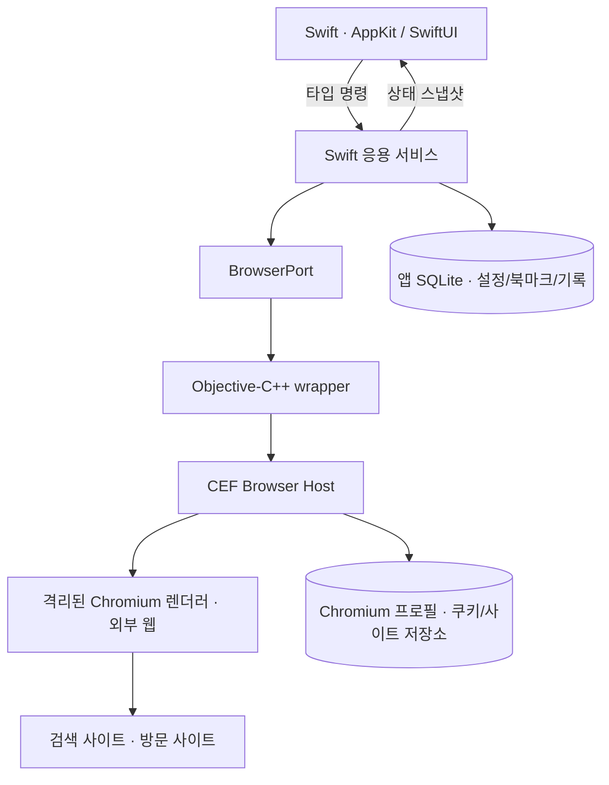

# Jena Web 기술 설계

- 작성일: 2026-11-10
- 기준: [PRD](prd.md), [기획서](product-plan.md)
- 상태: 2026-11-12 사용자 결정으로 Swift·AppKit + CEF 채택 확정. 추가 기술 검증 종료. 현재 제품 구현 구조는 [프로그램 구조](program-structure.md)를 따른다. 아래 과거 검증 조건은 채택을 다시 보류하는 근거로 사용하지 않는다.
- 결정 기록: [아키텍처 기록](architecture-log/2026-11-10-desktop-design.md)
- 검증 계획: [설계 검증 계획](design-validation.md)

## 1. 설계 전제와 범위

단일 기기의 사용자 한 명이 여러 웹페이지를 탐색하는 로컬 데스크톱 앱을 전제로 한다. 탭 수·메모리 예산·개발 인원은 아직 정해지지 않았다. macOS 네이티브 품질을 우선한다. Windows는 장기 목표로만 남기며, 현재 구조를 OS 간 코드 공유에 맞추지 않는다.

현재 저장소에는 제품 문서와 validation/의 기존 구현·실험 기록, Sources/의 제품 소스 골격이 있다. 재사용할 동작은 프로그램 구조의 연결 표에 따라 제품 코드에 연결한다. 서버, 계정 시스템, 검색 API, 동기화 서비스는 추가하지 않는다. 데이터 보존은 PRD에 따라 로컬에서 수행한다. 서버용 무상태·외부 DB 원칙은 이 데스크톱 프로필에는 적용하지 않는다.

이 문서는 구현 설계이며 PRD의 미확정 제품 정책을 승인된 기본값으로 바꾸지 않는다. 2026-11-12 구조 작업에서는 제품 소스 디렉터리를 생성했다. 기능 구현·의존성 설치·배포는 별도 작업이다.

## 2. Swift 기반 macOS 구성

**확정 방향: 앱 언어는 Swift, UI는 macOS 네이티브. Electron·React·TypeScript 기반 앱 구성은 철회한다.** Blink 요구는 유지한다. AppKit을 제품 UI의 기본으로, CEF를 웹 엔진으로 채택했다. SwiftUI는 필요할 때 독립 보조 화면에 부분 적용할 수 있다. SQLite는 기존의 앱 데이터 저장 후보로 유지한다.

| 영역 | 설계 제안 | 검증 사항 |
|---|---|---|
| 창·탭·주소 입력·웹 뷰 호스트 | Swift + AppKit 중심 | responder chain, IME, 드래그, 포커스, 창 크기 변경 |
| 설정·북마크 관리 등 보조 화면 | SwiftUI 사용 검토, 필요 시 AppKit과 통합 | 접근성·키보드·상태 갱신, 웹 뷰와의 레이아웃 충돌 |
| 외부 웹 콘텐츠 | CEF를 통한 Chromium/Blink 임베딩 채택 | 프로필·쿠키·권한·삭제, 네이티브 뷰 통합과 배포 |
| 앱 로직 | Swift의 기능별 서비스·타입 계약 | 엔진 콜백과 UI 갱신의 스레드 경계 |
| 앱 저장소 | SQLite 후보 유지 | 직렬 쓰기·마이그레이션·실패 복구 |

CEF는 외부 앱의 Chromium 임베딩을 지원하며 macOS의 뷰 핸들로 NSView를 사용한다. **Swift → Objective-C++ wrapper → CEF C++**를 제품 연결 구조로 사용한다. Swift 도메인에 CEF 타입·포인터를 노출하지 않고 wrapper에서 수명·스레드·오류를 관리한다. 공식 Swift 바인딩이 있다고 가정하지 않는다. [CEF 공식 개요](https://github.com/chromiumembedded/cef/blob/master/docs/general_usage.md)

SwiftUI에 AppKit 뷰가 필요한 경우 NSViewRepresentable을 사용할 수 있다. 다만 웹 호스트 뷰를 SwiftUI 상태 갱신 때마다 재생성하지 않도록 소유권을 별도로 유지한다. [Apple 공식 문서](https://developer.apple.com/documentation/swiftui/nsviewrepresentable)

CEF 채택은 확정했다. 이후 제약은 제품 구현 작업으로 처리하고, CEF가 담당하지 않는 기능은 macOS 네이티브 등 적절한 구현에 연결한다. 추가 엔진 비교·채택 검증을 요구하지 않는다.

## 3. 프로세스와 신뢰 경계

- Swift 응용 서비스가 앱 정책을 소유하고, UI와 창·탭 호스트의 변경은 MainActor에서 수행한다. CEF의 UI thread와 Swift MainActor가 자동으로 같은 실행 문맥이라고 가정하지 않는다.
- 네이티브 UI는 웹페이지가 아니다. 앱 UI용 preload·Node 런타임·웹 UI IPC는 두지 않는다.
- 외부 페이지에는 파일·북마크·설정·삭제 명령으로 이어지는 JavaScript 바인딩을 제공하지 않는다. 엔진 프로세스 메시지가 필요하면 browser/frame 식별자와 수명·입력을 검증한다.
- 웹 콘텐츠의 보안 격리와 인증서 검증을 유지한다. macOS helper 프로세스·sandbox·서명 요건은 CEF 버전별로 확인한다. 초기화 편의를 위해 sandbox를 해제하는 방식으로 통과 처리하지 않는다.
- 앱 창·메뉴·설정은 네이티브 UI에서만 생성하며 외부 링크는 NavigationService를 거친다.
- 웹사이트는 폭넓게 탐색할 수 있지만 스킴은 구분한다. file·내부 앱 스킴·외부 앱 호출은 HTTP/HTTPS와 같은 경로로 실행하지 않는다.
- 페이지 제목·파비콘은 비신뢰 입력이다. 주소는 엔진의 실제 탐색 상태를 사용한다.

CEF의 macOS 구성에는 별도 helper 실행 파일·앱 번들 등 플랫폼별 초기화가 필요하다. Swift 앱의 실행 진입점과 엔진 메시지 루프·종료 순서의 통합을 PoC에서 검증한다. [CEF 튜토리얼](https://github.com/chromiumembedded/cef/blob/master/docs/tutorial.md)

## 4. 모듈과 의존성

제품 소스 골격을 `Sources/`에 생성했다. 현재 디렉터리·타입 배치·소유권은 [프로그램 구조 §2–5](program-structure.md)를 따른다. 기존 기능별 모듈 원칙은 유지하고 AppKit 화면 연결은 workspace, 앱 데이터 저장은 storage로 분리했다.

각 기능 내부는 필요한 만큼 domain/application/adapters를 둔다. 도메인은 AppKit·SwiftUI·CEF·SQLite에 의존하지 않는다. 응용 서비스가 포트로 부수효과를 호출하고 초기화 코드가 구현체를 연결한다. 단순 CRUD에 이벤트 버스·CQRS·분산 트랜잭션은 도입하지 않는다.

| 경계 | 책임 | 주요 계약 |
|---|---|---|
| SearchService | 제공처·모드 검증, URL 구성 | resolveSearch(providerId, mode, query) |
| NavigationService | 입력 분류와 탭 목적지 결정 | resolveInput, decideNavigation |
| TabService | 탭 생성·선택·종료와 상태 | open, activate, requestClose |
| BrowserPort | 엔진 구현을 격리 | createPage, navigate, goBack, reload, requestClose, observe |
| ProfilePort | 프로필 능력·정책·삭제 실행 | capabilities, planRemoval, executeRemoval |
| BookmarkRepository | 북마크의 단일 저장 경계 | list, create, update, remove |
| HistoryRepository | 방문 기록과 선택 삭제 | recordVisit, deleteMatching |
| PolicyService | 사이트와 OS 권한 조합 | resolvePermission, changePolicy |

## 5. 명령·이벤트 계약

Swift 내부 타입 계약 초안이며 HTTP 서버나 웹 UI IPC는 없다. 아래 점 표기 명령은 논리적 이름이다. Swift enum·struct·protocol로 표현하고 CEF callback은 wrapper에서 변환한다.

| 명령 | 입력 | 결과 |
|---|---|---|
| search.submit | requestId, tabId, providerId, mode, query | navigationId 또는 검증 오류 |
| navigation.open | requestId, tabId, address, disposition | navigationId |
| tab.activate / tab.close | requestId, tabId | 변경된 탭 snapshot |
| bookmark.save | requestId, id?, title, url, expectedVersion? | 저장된 항목·version |
| settings.update | requestId, expectedVersion, 허용된 변경 필드 | 적용된 설정·version |
| privacy.preview | requestId, profileId, 선택 종류·범위 | planId, 만료시각, 실제 대상·영향·미지원 항목 |
| privacy.execute | requestId, planId | jobId 및 항목별 진행·결과 |

공통 오류는 InvalidInput / UnsupportedCapability / Conflict / PermissionDenied / StorageFailure / NavigationFailure / PartialFailure로 구분한다. 원시 엔진 오류·경로·토큰을 UI나 로그에 그대로 노출하지 않는다.

응용 서비스는 tab.updated, settings.changed, privacy.progress 이벤트를 단조 증가 revision과 함께 보낸다. UI는 tabId·navigationId·revision을 확인해 닫힌 탭이나 이전 탐색의 늦은 이벤트를 무시한다. requestId 중복은 동일 명령을 재실행하지 않도록 실행 중 목록으로 억제한다. 이를 재시작을 넘는 영구 exactly-once 보장으로 해석하지 않는다.

## 6. 상태와 데이터 모델

| 상태 | 권위 있는 소유자 | 수명 |
|---|---|---|
| 입력 중 검색어·포커스·설정 초안 | 해당 UI 화면 | 화면 수명 |
| 활성 탭·탭 순서·로딩 상태 | Swift TabService, 실제 페이지 상태는 엔진 | 앱 실행 중 |
| 뒤로·앞으로 목록, 현재 실제 URL | 엔진 | 페이지 생명주기 |
| 앱 설정·북마크·방문 기록 | SQLite | 명시적 변경·삭제까지 |
| 쿠키·웹 저장소·HTTP 캐시 | 엔진 프로필 | 사이트 정책·사용자 삭제까지 |
| 실제 로그인 유효성 | 해당 사이트 서버 | 사이트가 결정 |
| 삭제 진행 상태 | PrivacyService | 작업 수명; 재시작 후 완료로 추정하지 않음 |

UI에 별도 로그인 true/false를 저장하지 않는다. 탭마다 서로 다른 프로필을 만들지 않는다. 일반 웹 탭은 하나의 영속 프로필을 공유하며 도메인 격리는 웹 엔진이 담당한다. CEF request context와 영속 캐시 경로를 통한 프로필 공유를 검증한다. 앱이 각 탭에 context를 임의로 새로 만들어 로그인 상태를 분리하지 않는다.

### 앱 DB 초안

| 테이블 | 주요 필드·제약 |
|---|---|
| app_setting | key PK, value_json, version, created_at, updated_at; key별 타입 검증 |
| bookmark | id PK, title, url, version, created_at, updated_at |
| visit | id PK, url, title, origin, visited_at, created_at, updated_at; visited_at·origin 인덱스 |
| site_policy | id PK, requesting_origin, embedding_site?, permission_type, decision, version, created_at, updated_at; 동일 scope·type 중복 금지 |
| schema_migration | version PK, checksum, applied_at |

SQLite는 앱 데이터만 소유한다. Chromium 쿠키·스토리지 DB를 직접 열거나 수정하지 않는다. UI에 DB 파일 접근을 제공하지 않는다. 한 DB 실행 큐에서 쓰기를 직렬화하고 MainActor의 UI 처리를 막지 않도록 전용 DB 실행 큐를 검증한다. actor 사용만으로 동기 DB 호출이 비차단으로 바뀐다고 가정하지 않는다. 버전 충돌 시 최신 값을 반환해 재편집하도록 한다.

검색 제공처 정의는 버전 관리하는 앱 리소스로 둔다. id, 표시 이름, 지원 모드, URL 생성 규칙만 포함하며 사용자 설정에는 선택 id를 저장한다. 웹·이미지 설정 공통/분리 결정은 이 카탈로그와 분리한다. 문자열 연결 대신 URL 인코딩 규칙을 사용한다.

앱 DB와 엔진 프로필 경로를 분리한다. 마이그레이션 전에는 일관된 스냅샷을 보존하고 실패 시 원본으로 되돌릴 경로를 검증한다. 단, 개인정보 삭제 직전에 삭제 대상 복사본을 자동 생성하지 않는다. 삭제가 과거 백업의 포렌식 완전 제거를 뜻하지 않음을 구분하고, 백업 보존·삭제 범위는 D06·D10에 포함한다.

## 7. 탐색·탭 제어

### 입력 처리

입력 → IME 조합 상태 확인 → 빈 입력 거절 → 명시 HTTP/HTTPS URL 파싱 또는 검색 의도 분류 → 제공처 URL 생성 → NavigationService → 대상 탭.

스킴 없는 주소와 로컬 주소는 D04의 결정이 필요하다. URL 생성은 부수효과 없는 함수로 두고 검색어를 로그에 남기지 않는다.

### 탐색 의도에 따른 분기

| 의도 | 처리 원칙 |
|---|---|
| 앱 검색·주소 입력 | 사용자 지정 대상 탭으로 이동 |
| 확인된 일반 결과 링크 탐색 | 현재/새 탭 설정 적용, 새 탭이면 원본 유지 |
| 페이지 내부 앵커·이미지 미리보기 | 엔진 기본 동작 유지 |
| 폼 제출·리디렉션·뒤로·새로고침 | 새 GET 요청으로 변환하지 않고 기존 문맥 유지 |
| 명시적 새 창 링크·스크립트 팝업 | 팝업 정책과 사용자 동작 근거 평가 후 앱 내부 처리 |
| 인증 팝업 | opener·쿠키·POST 문맥 보존이 검증된 경로로 처리 |
| 외부 앱 스킴·다운로드 | D05 확정 전 일반 탐색 경로로 실행하지 않음 |

**초기 검증 가정:** 엔진 탐색 이벤트만으로 모든 페이지의 일반 링크·폼·스크립트 의도를 완벽히 구분할 수 있다고 가정하지 않는다. 일반 링크의 새 탭 정책은 반드시 PoC에서 검증한다. 제한된 격리 스크립트로 클릭 의도를 보조 관찰하는 안은 가능하지만 DOM 정보는 비신뢰 입력이며 권한·시스템 작업을 허용하는 근거로 쓰지 않는다. 제스처·요청 메서드를 확인하지 못한 이동을 임의로 복제하지 않는다.

후속 G02 전체 수용 검증에서 격리 world의 링크 기본 동작 변경, OOPIF별 정책 설치, 명시적 새 문맥의 OnOpenURLFromTab 처리, 엔진 popup의 native 호스트 수용 방식을 확정했다. 일반 링크·폼·스크립트·미리보기 분리와 실제 Google·네이버 클릭을 확인했다. 기준 소스와 잔여 범위는 [확정 기록](devlog/2026-11-11-navigation-acceptance.md)을 따른다.

CEF의 탐색·팝업 생명주기 callback을 BrowserPort로 변환한다. 단순히 URL만 새로 로드하면 opener·POST를 잃을 수 있으므로, 엔진이 생성한 브라우저를 관리 탭의 네이티브 호스트에 수용하는 경로와 일반 링크 이동을 구분해 실험한다. 구체 callback과 생성 방식은 선정 버전에서 확인한다.

탭 상태는 creating → ready/loading → ready/failed → closing → closed로 관리한다. 사용자 닫기 요청에서는 beforeunload 등 페이지의 미저장 입력 보호를 존중한다. 비활성 탭은 표시만 해제하고 임의로 종료하지 않는다. 메모리 절감을 위한 자동 탭 폐기는 요구사항에 없다.

설정·확인 화면이 열린 동안 외부 웹 호스트 NSView가 위에 덮여 클릭을 가로채지 않도록 AppKit 창 계층과 responder를 관리한다. 웹 호스트의 frame·배율을 창 레이아웃과 동기화한다. 표시를 숨기는 것과 페이지 종료는 분리한다.

탭·브라우저 객체는 안정된 tabId로 소유한다. SwiftUI 갱신은 뷰를 갱신할 뿐 엔진 인스턴스를 재생성하지 않는다. wrapper는 CEF 참조와 delegate 수명을 관리하며, close 완료 이후 callback이 폐기된 Swift 객체를 호출하지 않도록 해제 순서를 검증한다. 탭 드래그·스크롤·창 리사이즈 중 프레임 시간, 입력 지연과 메인 스레드 점유를 측정한다.

## 8. 로그인·권한·쿠키

- 엔진이 사이트에서 받은 영속 쿠키와 저장소를 관리한다. 앱은 비밀번호를 추출하거나 자체 세션 테이블에 쿠키를 복제하지 않는다.
- 정상 종료·재실행, 서버 취소, 명시적 로그아웃, 종료 시 만료 세션을 각각 검증한다. 영속 프로필 사용만으로 모든 요구를 통과했다고 판단하지 않는다.
- 인증 실패를 피하려고 User-Agent를 속이거나 외부 브라우저의 프로필을 복사하지 않는다. 제공처가 임베디드 로그인을 제한하면 지원 제약으로 기록한다.
- 권한 결정은 요청 origin, 포함한 최상위 사이트, 권한 종류, OS 상태를 함께 평가한다. 요청 콜백과 권한 조회 콜백에 같은 정책을 적용한다.
- 후속 [권한·삭제 수정 검증](devlog/2026-11-11-permission-privacy-fix.md)에서 명시적 거절·초기화와 엔진 조회 일치, 재실행 유지, 도메인 소유 쿠키·지정 origin 저장소 삭제를 확인했다(79/79). 현재 probe는 같은 요청/최상위 origin의 거절·초기화만 설정하며 임의의 cross-origin 쌍 설정을 거절한다. OS 허용·복구와 전체 저장소 탐색은 미검증이며 위 제품 요구를 대체하지 않는다.
- [G06 추가 검증](devlog/2026-11-11-g06-validation.md)에서 임베디드 미디어 권한의 조회 불일치와 단독 origin 설정으로의 거절 전파가 재현됐다(19 통과·6 실패). 당시 callback에서 origin별 BLOCK을 저장하는 구현은 임베디드 권한 요구를 충족하지 못한다. 후속 [OS 수동 검증](devlog/2026-11-11-g06-manual-validation.md)에서 네 권한의 거부 상태·설정 변경 후 복구를 확인했다. 다만 웹 요청·OS 권한 결합 및 자동 재실행 검증은 남아 있다. iframe에 관한 최신 판정은 아래 후속 검증을 따른다.
- 2026-11-12 사용자 결정: iframe 카메라·마이크는 **이번 요청만 거절하고 다른 저장 권한은 유지**한다. callback 취소와 영구 차단을 구분한다. [iframe 수정 검증](devlog/2026-11-12-iframe-permission-fix.md)에서 단독 사이트 권한으로의 전파를 막고 47/47을 통과했다. 요청 거절 후 query prompt는 이 정책의 정상 상태이며, iframe 독립 영구 차단을 지원한다는 의미는 아니다.
- effective permission은 저장 정책과 OS 허용의 조합에서 계산한다. OS가 거부하면 앱에 허용으로 저장되어 있어도 실제 사용 가능으로 표시하지 않는다.
- 서드 파티 판별은 단순 hostname 비교가 아니다. schemeful site·공개 접미사·iframe·분할 쿠키 맥락을 고려해야 한다.
- Cookie/Set-Cookie 헤더만 제거하는 구현은 JS 쿠키·저장소·분할 쿠키 정책을 충족한다고 볼 수 없다. 공식 지원 경로를 검증하지 못하면 R12 미충족으로 기록하고 스택 재검토 대상으로 올린다.
- 제품 기본값(D08)이 결정되기 전에는 사용자에게 배포할 기본 정책을 확정하지 않는다. 검증용 설정은 임시 테스트 프로필에만 적용한다.

## 9. 개인정보 삭제 설계

### 삭제 계획과 실행

1. 선택한 종류·기간·사이트를 정규화한다. origin, 쿠키 domain, top-level site, partition key를 같은 문자열로 취급하지 않는다.
2. 엔진 capability를 확인하고 실제 삭제 대상과 범위를 산출한다. 범위를 정확히 표현할 수 없으면 UnsupportedCapability를 반환한다. 사이트 삭제를 전체 프로필 삭제로 대체하지 않는다.
3. planId·설정 revision·만료시각을 발급한다. UI는 실제 영향과 미지원 항목을 보여준다.
4. 사용자가 확인하면 plan을 재검증한다. 대상·정책이 달라졌으면 새 계획을 요구한다.
5. 프로필별 삭제 작업을 직렬화한다. 앱 DB 삭제와 엔진 삭제는 서로 다른 작업 단위로 실행한다.
6. 유형별 성공·실패를 반환한다. 앱 DB와 엔진 간 원자적 트랜잭션을 약속하지 않는다. 재시도는 실패한 항목에 한정하며 삭제 데이터를 복원해 성공 상태를 꾸미지 않는다.

CEF 버전별 공개 API로 원점·쿠키 domain·저장소별 선택 삭제를 충족할 수 있는지 먼저 확인한다. 쿠키 삭제와 캐시 삭제만으로 IndexedDB·service worker까지 지워진다고 판단하지 않는다. 지원 API가 부족하면 미충족으로 보고하고 엔진 통합 결정을 보류한다. Chromium 내부 DB 직접 편집이나 프로필 전체 삭제로 우회하지 않는다.

### 열린 페이지와 동시성

열린 탭이나 service worker가 삭제 후 데이터를 다시 만들 수 있다. 작업 중 관련 탐색을 보류하는 것만으로 worker 쓰기까지 멈춘다고 가정하지 않는다. 엔진이 제공하는 처리·재검증 경로를 조사한다. 확실한 정지가 필요하면 사용자가 관련 탭을 직접 닫은 뒤 재시도하는 절차를 제안하고, 앱이 임의로 탭을 닫지 않는다. 이 흐름의 최종 UX는 D06에서 확정한다.

삭제 완료는 명시한 범위의 작업 완료를 뜻하며 미래 쓰기 금지를 뜻하지 않는다. 삭제 중단·앱 종료 후에는 작업 완료를 추정하지 않고 확인 필요 상태로 표시한다. 사이트 목록이나 인증 정보를 영구 작업 로그에 불필요하게 남기지 않는다.

## 10. 검증과 후속 순서

2026-11-12 사용자 지시로 추가 기술 검증은 종료했다. CEF 채택을 전제로 프로그램 구조 → 제품 프로젝트 연결 → 기존 탐색·탭 코드 연결 → 앱 저장소와 설정 화면 구현 순으로 진행한다. 이미 완료한 검증을 반복하거나 PRD 기능을 임의로 제거하지 않는다.

아래 문단은 당시의 검증 상태 기록이며 현재의 채택 보류 조건이 아니다.

현재 완료 범위는 구조·상태·데이터·명령·탐색·삭제 설계와 12차까지의 부분 PoC다. 네이티브 뷰·프레임·RSS 기초 측정은 수행했지만 성능 예산은 미정이다. 후속 [탐색 분류 수정](devlog/2026-11-11-navigation-classification-fix.md)에서 JavaScript 이동 오분류는 해결했다. 후속 G02 전체 수용 매트릭스도 통과해 탐색 방식을 확정했다. 실제 계정 인증, OS 권한·임베디드 origin별 정책, 쿠키·삭제의 전체 경계는 미해결이며 전체 게이트 통과로 판단하지 않는다.
